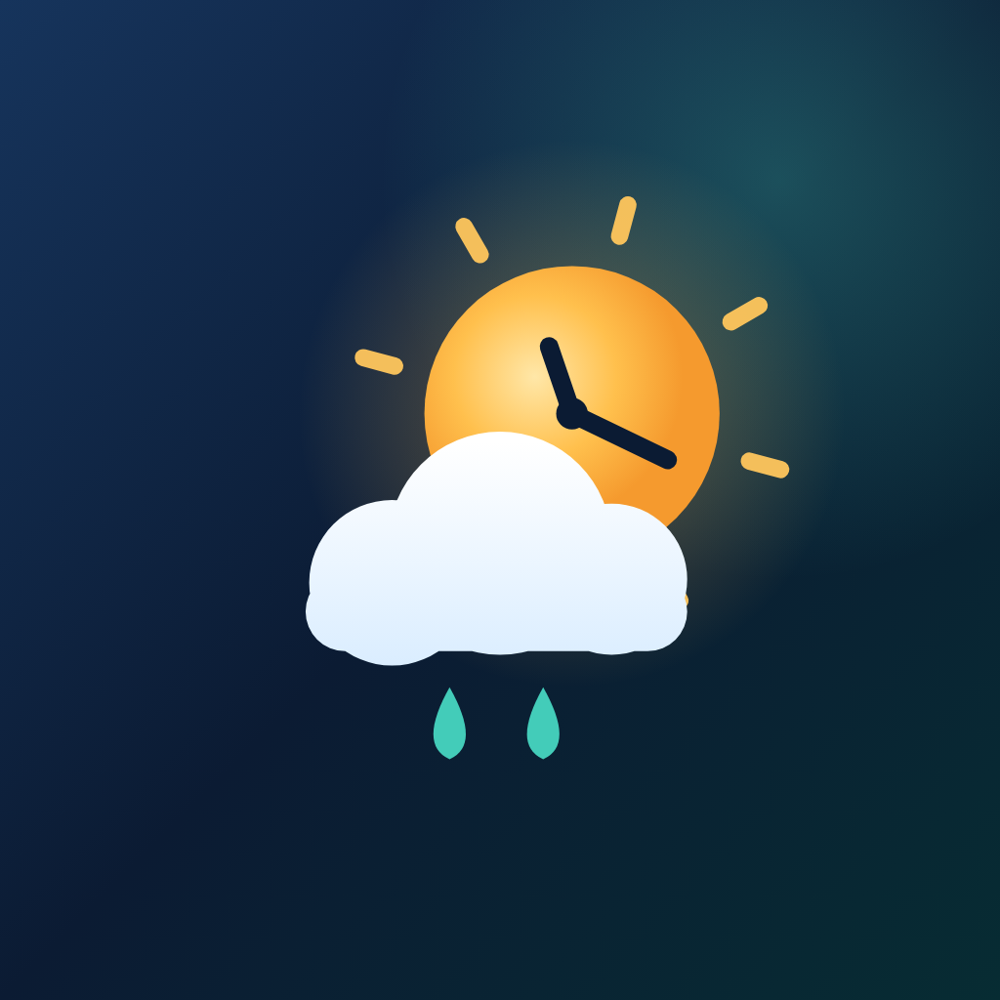

<div align="center">



# أجواء · Ajwaa

**الطقس والوقت، أينما كنت**
*Weather & time, wherever you are*

[](https://flutter.dev)
[](https://dart.dev)
[](#-platforms)
[](#-testing)
[](#-data-sources)

</div>

---

## English

A bilingual (Arabic / English) mobile weather app that answers the everyday
question **“what is it like outside, right now, where I am?”** — the current
temperature, rain, dust, humidity, cyclones and the **exact local time** for the
place you are looking at.

The whole app is built around two ideas:

1. **Time belongs to the place.** A weather card is useless if you cannot tell
   what “now” means there. Every screen carries the city's own clock, offset and
   date.
2. **Arabic is a first-class citizen, not a translation.** Layout, numerals,
   typography, direction and copy were designed for both languages from the
   start — not mirrored afterwards.

### ✨ Features

| | |
|---|---|
| **Live GPS weather** | One tap resolves your coordinates, reverse-geocodes them, and shows the forecast for exactly where you are. Refreshes automatically every 10 minutes, on pull-to-refresh, and when you move more than 5 km. |
| **Local time everywhere** | A ticking clock per city with its UTC offset, localized weekday and date. Numerals stay Western (`20:04:42`) in both languages, as is customary in Gulf/Levant weather apps. |
| **Rain, dust and air** | A dedicated section with dust concentration and a 24-hour curve, PM10 / PM2.5 / AQI, plus rain probability, totals and a “next wet hour” strip. |
| **Dust & visibility focus** | Dust level (low → very high), UV index and AQI are classified with WHO/WMO-style thresholds and surfaced both in the grid and as alerts. |
| **Cyclone tracking** | Active tropical systems from NASA EONET, with GDACS as a fallback. Distance from your city, wind speed in km/h, and an alert level (info / warning / severe). |
| **Smart alerts** | A small rules engine turns the snapshot into actionable warnings: heat, cold, wind, rain, dust, UV, thunderstorms and nearby cyclones — each with its own severity. |
| **7-day outlook** | Temperature range bars normalized across the week, rain probability, wind and UV; tap a day for the full breakdown. |
| **Sun path** | Sunrise/sunset arc with the sun's position at the current local time. |
| **Multiple cities** | Search any city on Earth (Open-Meteo geocoding, localized names), save favourites, remove them with a swipe-to-dismiss, and switch instantly. |
| **Bilingual + RTL** | Full Arabic and English UI, instant switching without restart, real RTL mirroring, bundled IBM Plex Sans Arabic. |
| **Light & dark** | Two hand-tuned atmospheric themes with animated weather scenes (clouds, rain, stars, sun glow). |
| **Offline-friendly** | The last good payload is cached for 10 minutes and served with a clear “offline” banner when the network fails. |
| **Accessible & responsive** | Semantics on every interactive element, both pointer devices and touch, layout from small phones to desktop web. |
| **No API keys** | Every data source is free and key-less, so the app can be cloned, run and deployed without accounts or secrets. |

### 📱 Platforms

| Platform | Status | Notes |
|---|---|---|
| **Web / PWA** | ✅ Built & verified | `flutter build web`, installable, branded first-paint loader. |
| **Android** | ✅ Configured | Adaptive + monochrome launcher icon, splash, `INTERNET` and location permissions, Arabic/English app name. Requires the Android SDK to build locally. |
| **iOS** | ✅ Configured | App icon set, launch screen, localized display name, location usage descriptions. Requires macOS + Xcode to build. |

> This repository was developed on Windows, so `flutter build web` is the build
> that was executed and visually verified end-to-end here. Android and iOS are
> fully configured (icons, splash, manifests, permissions) and compile from the
> same Dart sources, but need their respective SDKs to produce binaries.

### 🧠 Architecture

```
lib/
├── main.dart                 # bootstrap: preferences + date formatting
├── app.dart                  # MaterialApp, themes, locale, scroll behaviour
├── core/                     # framework-agnostic foundations
│   ├── constants/            # app metadata, endpoints, storage keys, cities
│   ├── errors/               # AppFailure + FailureKind (typed, localizable)
│   ├── network/              # ApiClient: retries, timeouts, UTF-8 decoding
│   ├── theme/                # light/dark themes, typography, spacing, radii
│   ├── utils/                # formatters, JSON readers, localized text
│   └── widgets/              # PressableScale, SurfaceCard, Reveal, Shimmer
├── domain/                   # pure rules, no Flutter or network
│   ├── units.dart            # metric ⇄ imperial at the presentation edge
│   ├── weather_condition.dart# WMO code → condition → localized label
│   ├── environment_levels.dart# dust / UV / AQI classification
│   ├── alerts.dart           # rules engine producing WeatherAlert
│   └── geo.dart              # haversine distance
├── data/
│   ├── models/               # City, WeatherBundle, Storm, AppSettings
│   ├── parsers/              # defensive JSON → model mappers
│   ├── services/             # one class per remote API
│   └── repositories/         # stores + WeatherRepository (merge & cache)
├── state/                    # Riverpod providers and controllers
├── presentation/
│   ├── home/                 # HomeScreen + its sections
│   ├── sheets/               # city picker, settings, welcome, info sheets
│   ├── theme/                # weather palettes
│   └── widgets/              # logo, scenes, glyphs, charts, sun path
└── l10n/                     # ARB catalogues + generated localizations
```

The dependency rule is strictly one-way:
**presentation → state → data → domain → core**. Nothing in `domain/` imports
Flutter, so every rule is unit-testable in isolation.

`Architectures.json` documents the same structure machine-readably: layers,
modules, responsibilities, key classes, data flow, storage schema, API contracts,
failure handling and the testing strategy. It is the reference document for
anyone extending the app.

### 🔌 Data sources

| Purpose | Provider | Key | Why |
|---|---|---|---|
| Forecast, hourly, daily, wind, visibility | [Open-Meteo](https://open-meteo.com) | — | Free for non-commercial use, no key, generous limits, 16-day horizon. |
| Dust, PM10, PM2.5, AQI, UV | [Open-Meteo Air Quality](https://open-meteo.com/en/docs/air-quality-api) | — | Only key-less source that exposes **dust** explicitly, which is the app's differentiator. |
| City search | [Open-Meteo Geocoding](https://open-meteo.com/en/docs/geocoding-api) | — | Localized place names (`language=ar`), timezone and country in one call. |
| Reverse geocoding | [BigDataCloud](https://www.bigdatacloud.net) | — | Key-less client endpoint with CORS enabled. |
| Active cyclones | [NASA EONET](https://eonet.gsfc.nasa.gov) | — | Public, CORS-enabled, includes storm intensity. |
| Cyclone fallback | [GDACS](https://www.gdacs.org) | — | Broader alert levels; used when EONET is empty or unreachable. |

All requests are **client-side and key-less**. Nothing is proxied through a
server, no analytics are collected, and location is only ever sent to those
public APIs as coordinates.

### 🚀 Getting started

```bash
# Requirements: Flutter 3.47+ (Dart 3.13+)
flutter --version

flutter pub get
flutter gen-l10n              # regenerate localizations from lib/l10n/*.arb

flutter run -d chrome         # fastest way to try it
flutter run -d <device-id>    # or an Android/iOS device
```

#### Regenerating branding

The icon, adaptive foreground, monochrome mask, splash logo and web loader mark
are rendered from the same vector code that draws the in-app logo, so they can
never drift apart:

```bash
flutter test tool/render_branding_test.dart   # writes assets/branding/*
dart run flutter_launcher_icons               # Android / iOS / web icons
dart run flutter_native_splash:create         # Android / iOS splash
```

### ✅ Testing

```bash
flutter analyze     # 0 issues
flutter test        # 46 tests
```

The suite is deliberately layered:

| File | What it protects |
|---|---|
| `test/parsers_test.dart` | Defensive parsing of real API payload shapes, including missing and mistyped fields. |
| `test/alerts_test.dart` | Severity ordering and thresholds of the alert rules engine. |
| `test/units_formatters_test.dart` | Unit conversion, localized formatting and dust/UV/AQI classifications. |
| `test/weather_repository_test.dart` | Cache freshness, offline fallback, 5 km invalidation, force refresh, malformed payloads. |
| `test/stores_test.dart` | Corrupt/partial persisted state falls back to safe defaults instead of crashing. |
| `test/widget_test.dart` | Home screen in English and Arabic (RTL), plus the offline error state. |
| `test/sheets_test.dart` | Settings (theme/units/language), city search + add, welcome flow, data-source and about sheets, recovery from corrupt storage. |

Widget tests avoid `pumpAndSettle` because the app has intentional infinite
animations (weather scenes, shimmer, live clock); they pump fixed frames and
dispose the tree explicitly instead.

### 📦 Building & deploying

```bash
# Web / PWA
flutter build web --release
# GitHub Pages project site: add the repository name as the base href
flutter build web --release --base-href /Weather_details_by_location/

# Android
flutter build apk --release        # or: flutter build appbundle --release

# iOS
flutter build ipa --release
```

`.github/workflows/web.yml` builds and publishes the web app to GitHub Pages on
every push to `main` (enable **Settings → Pages → Source: GitHub Actions** first).

### 🔒 Privacy

Ajwaa has no backend, no account, no analytics and no ads. Preferences and the
last weather payload live in local storage on your device. Your coordinates are
sent only to the public weather APIs listed above, and only to fetch the forecast
you asked for. Location permission is optional: you can use the app entirely by
picking cities.

### 🎨 Design notes

- **Palette** — deep navy `#0B1B33` and teal `#2E8B7A` for structure, gold
  `#F2A65A` for sunlight. Severity ramps from teal (info) to amber (warning) to
  red (severe) so a glance is enough.
- **Type** — IBM Plex Sans Arabic (bundled, OFL) across Latin and Arabic so the
  two languages share rhythm; Western numerals for measurements, localized
  month/weekday names.
- **Motion** — staggered `Reveal` entrances, `PressableScale` tactile feedback,
  drifting clouds and rain in the hero, animated sun arc, and a subtle shimmer
  while loading. All motion respects the platform's accessibility settings.
- **Sheets** — every detail is reachable by tapping its card; each sheet explains
  *what* the number means and *why* it matters, not just its value.

### 👤 Author

**Mohamed Ibrahim Mustafa** — [@mibrahimmustafa](https://github.com/mibrahimmustafa)

Built with Flutter & Riverpod. Forecasts by Open-Meteo, cyclones by NASA EONET /
GDACS, place names by BigDataCloud. IBM Plex Sans Arabic is licensed under the
SIL Open Font License (see `assets/fonts/OFL-IBMPlexSansArabic.txt`).

---

<div dir="rtl" align="right">

## العربية

تطبيق طقس ثنائي اللغة (عربي / إنجليزي) يجيب عن السؤال اليومي:
**«كيف الجو الآن، في مكاني؟»** — درجة الحرارة، المطر، الغبار، الرطوبة،
الأعاصير، و**الوقت المحلي الدقيق** للمدينة التي تنظر إليها.

قام التطبيق على فكرتين:

1. **الوقت ملكٌ للمكان.** بطاقة طقس بلا ساعة لا تخبرك ماذا يعني «الآن» هناك؛
   لذلك تحمل كل شاشة ساعة المدينة وإزاحتها الزمنية وتاريخها.
2. **العربية أصلٌ لا ترجمة.** التخطيط والأرقام والخطوط والاتجاه والنصوص
   صُمِّمت للغتين معًا من البداية، ولم تُعكس لاحقًا.

### ✨ المزايا

- **طقس بموقعك الحقيقي** — نقرة واحدة تحوّل إحداثياتك إلى مدينة وتعرض طقس
  مكانك بالتحديد. تحديث تلقائي كل ١٠ دقائق، وعند السحب للأسفل، وعند تحرّكك
  أكثر من ٥ كم.
- **الوقت المحلي في كل مكان** — ساعة حيّة لكل مدينة مع إزاحتها الزمنية
  واليوم والتاريخ بالعربية. تبقى الأرقام لاتينية كما هو معتاد في تطبيقات
  الطقس العربية.
- **المطر والغبار والهواء** — قسم مخصّص لتركيز الغبار مع منحنى ٢٤ ساعة،
  وPM10 وPM2.5 ومؤشر جودة الهواء، واحتمال المطر وكمياته وشريط «أقرب ساعة مطر».
- **تركيز على الغبار والمدى البصري** — تصنيف الغبار (منخفض ← مرتفع جدًا)
  ومؤشر الأشعة فوق البنفسجية وجودة الهواء وفق عتبات منظمة الصحة العالمية
  والأرصاد العالمية، تظهر في الشبكة وفي التنبيهات.
- **متابعة الأعاصير** — الأعاصير النشطة من NASA EONET مع GDACS كبديل،
  وبُعدها عن مدينتك وسرعة رياحها ومستوى التنبيه (معلومة / تحذير / خطير).
- **تنبيهات ذكية** — محرّك قواعد صغير يحوّل اللقطة الجوية إلى تحذيرات عملية:
  حرارة، برودة، رياح، مطر، غبار، أشعة، عواصف رعدية، وأعاصير قريبة.
- **توقعات ٧ أيام** — أشرطة مدى حراري موحّدة على مستوى الأسبوع، مع تفصيل
  كامل عند الضغط على أي يوم.
- **مسار الشمس** — قوس الشروق والغروب مع موقع الشمس في الوقت المحلي الحالي.
- **مدن متعددة** — ابحث عن أي مدينة (أسماء محلية بالعربية)، واحفظ مدنك
  المفضلة، واحذفها بالسحب، وبدّل بينها فورًا.
- **عربي وإنجليزي مع RTL** — تبديل فوري دون إعادة تشغيل، وانعكاس كامل
  للاتجاه، وخط IBM Plex Sans Arabic مضمّن في التطبيق.
- **فاتح وداكن** — سمتان جوّيتان مع مشاهد متحركة (سحاب، مطر، نجوم، وهج شمس).
- **يعمل بلا اتصال** — تُحفظ آخر بيانات صالحة ١٠ دقائق وتُعرض مع شريط واضح
  عند انقطاع الشبكة.
- **بلا مفاتيح API** — كل المصادر مجانية ولا تحتاج تسجيلًا، فيمكن استنساخ
  المشروع وتشغيله ونشره دون أي إعدادات سرّية.

### 🧠 البنية

المعمارية طبقية باتجاه واحد:
**العرض ← الحالة ← البيانات ← النطاق ← النواة**، ولا يستورد `domain/` أي
شيء من Flutter، لذا كل قاعدة قابلة للاختبار وحدها.

ملف `Architectures.json` يوثّق البنية آليًا: الطبقات، والوحدات، والمسؤوليات،
والأصناف الأساسية، ومسار البيانات، ومخطط التخزين، وعقود الـAPI، ومعالجة
الأخطاء، واستراتيجية الاختبار.

### 🚀 التشغيل

```bash
flutter pub get
flutter gen-l10n
flutter run -d chrome
```

### ✅ الاختبار

```bash
flutter analyze     # لا توجد ملاحظات
flutter test        # ٤٦ اختبارًا
```

### 🔒 الخصوصية

لا خادم، ولا حساب، ولا تحليلات، ولا إعلانات. تبقى تفضيلاتك وآخر بيانات
الطقس على جهازك، وتُرسَل إحداثياتك فقط إلى واجهات الطقس العامة المذكورة
أعلاه ولغرض جلب التوقعات التي طلبتها. إذن الموقع اختياري: يمكنك استخدام
التطبيق بالكامل عبر اختيار المدن.

### 👤 إعداد

**محمد إبراهيم مصطفى** — [@mibrahimmustafa](https://github.com/mibrahimmustafa)

</div>
